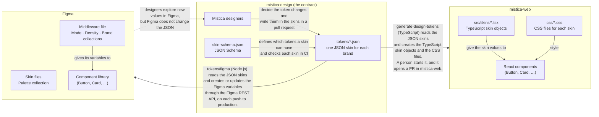
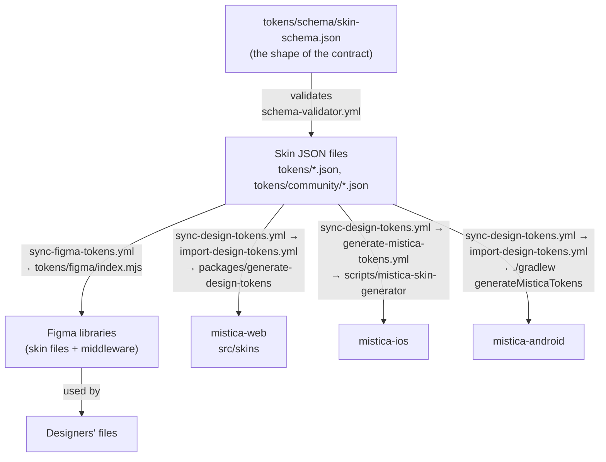
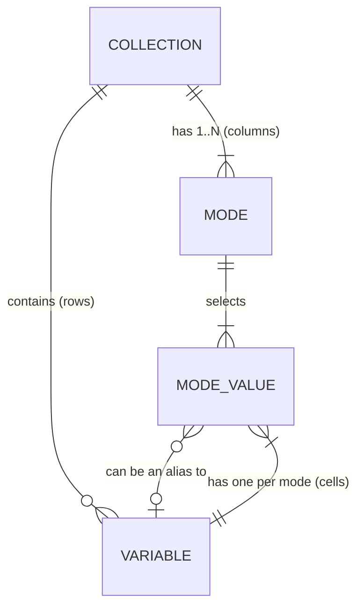
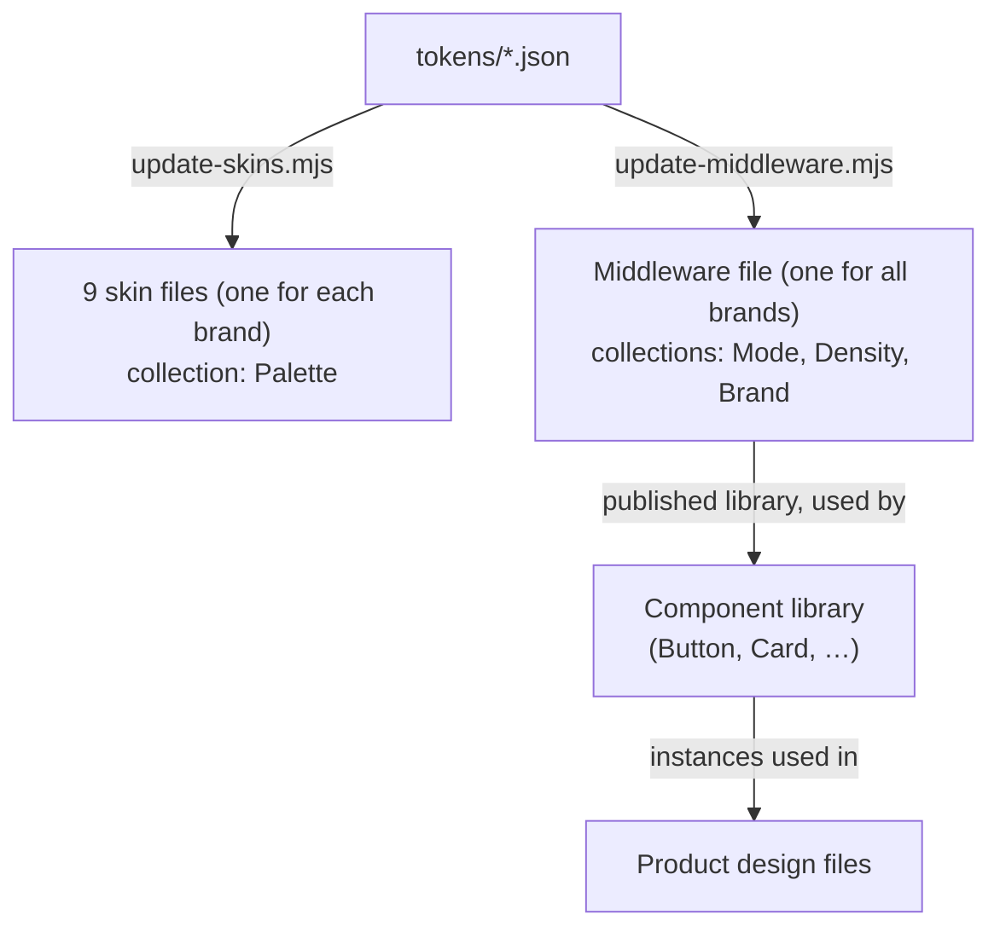
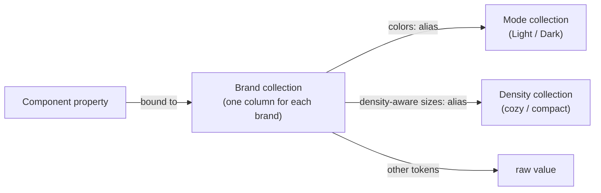
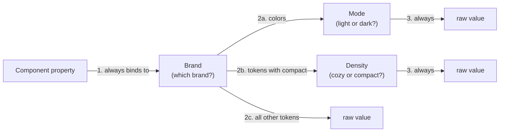
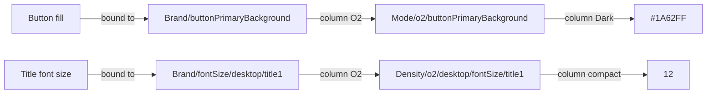
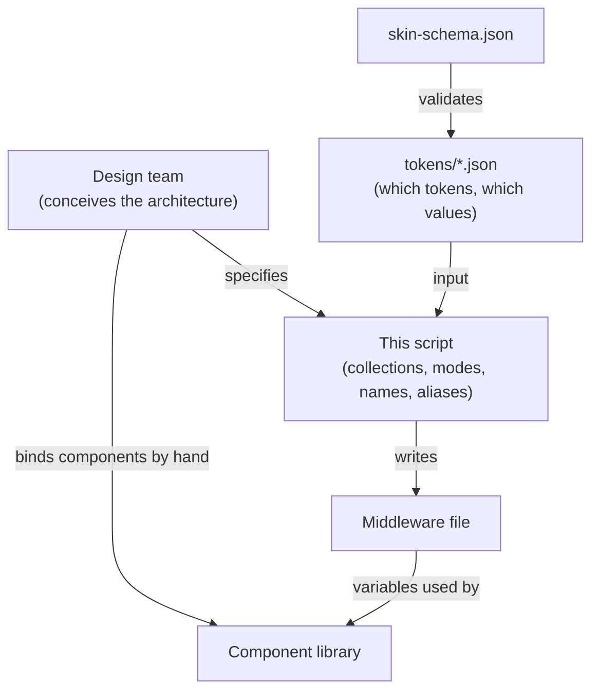
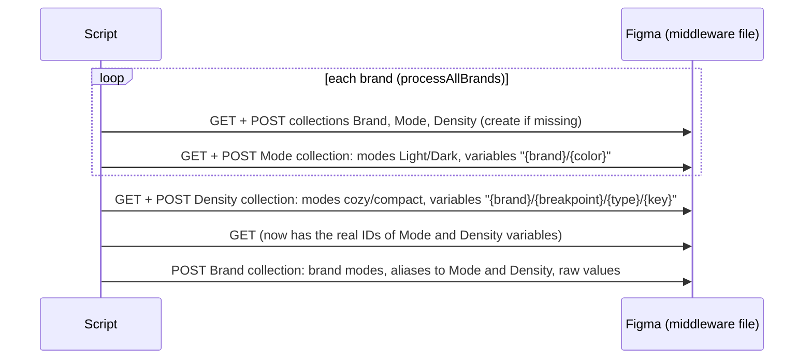
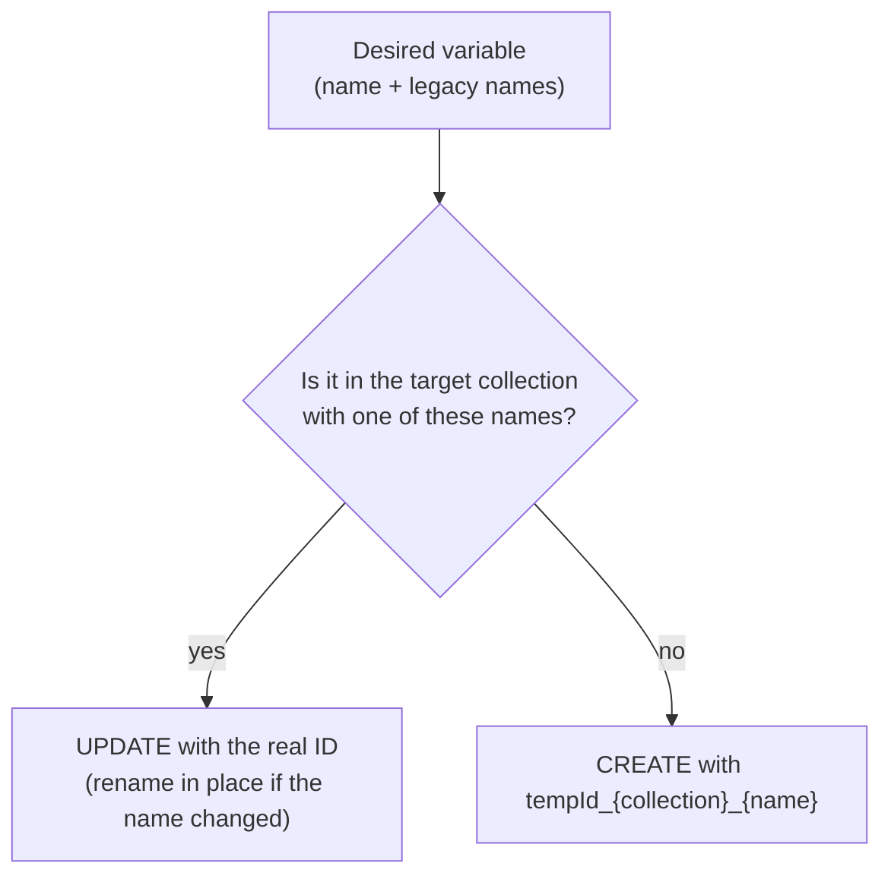

# Figma tokens sync

This folder contains the script that writes the Mística design tokens into Figma as **variables**.

This document is for designers and developers. It starts with the general concepts and then becomes more specific:

1. [The contract: the token JSON files](#1-the-contract-the-token-json-files)
2. [Figma variables in five minutes](#2-figma-variables-in-five-minutes)
3. [The Figma architecture of Mística](#3-the-figma-architecture-of-mística)
4. [A full example](#4-a-full-example)
5. [Who decides what](#5-who-decides-what)
6. [How the sync works](#6-how-the-sync-works)
7. [How to change the structure](#7-how-to-change-the-structure)
8. [Run the script](#8-run-the-script)
9. [Known quirks](#9-known-quirks)
10. [Glossary](#10-glossary)

---

## 1. The contract: the token JSON files

The JSON files in `tokens/` are the **single source of truth** for Mística. They are the contract between design (Figma) and code (mistica-web, mistica-ios, mistica-android).

### 1.1 Eagle-eye view



The **designers** own the tokens. Figma is a tool and a consumer, not the source:

1. A designer can explore a new value in Figma.
2. The designer writes the change in the JSON skin in a pull request. This is the moment when the change becomes real.
3. After the merge, the sync sends the change to Figma, and a manual sync sends it to mistica-web.

The solid arrows go **out of** mistica-design only. No tool writes back to the JSON files. If a designer changes a managed variable directly in Figma, the next sync overwrites it.

The same idea in each language:

| | mistica-web | mistica-design | Figma |
|---|---|---|---|
| **Language** | TypeScript and CSS | JSON, validated by JSON Schema | Figma Variables: collections, modes, aliases |
| **A token is…** | a property of a skin object | a key with a `value` (raw, `{palette.X}`, breakpoints, or `density`) | a variable with one value for each mode |
| **A brand is…** | one `.tsx` skin file | one JSON file | one mode of the Brand collection |
| **Light/dark is…** | the light and dark values of a skin | the `light` and `dark` keys | the modes of the "Mode" collection |
| **Translator** | `packages/generate-design-tokens` | – | `tokens/figma/index.mjs` |
| **Trigger** | manual (`sync-design-tokens.yml`), then a PR | – | automatic on push to `production` (`sync-figma-tokens.yml`) |

### 1.2 Files and workflows

| File | Role |
|---|---|
| `tokens/schema/skin-schema.json` | The shape of the contract: which tokens can exist, and which values they accept |
| `tokens/*.json`, `tokens/community/*.json` | One **skin** for each brand: the values of the tokens |



| Consumer | Trigger in this repo | Workflow in the consumer repo | Generator | Result |
|---|---|---|---|---|
| Figma | `sync-figma-tokens.yml` (automatic on push to `production`, or manual) | – | `tokens/figma/index.mjs` (this folder) | variables in the skin files and in the middleware |
| [mistica-web](https://github.com/Telefonica/mistica-web) | `sync-design-tokens.yml` (manual) | `import-design-tokens.yml` | `packages/generate-design-tokens` | a PR that updates `src/skins` and `css/` |
| [mistica-ios](https://github.com/Telefonica/mistica-ios) | `sync-design-tokens.yml` (manual) | `generate-mistica-tokens.yml` | `scripts/mistica-skin-generator` (`npm run generate`) | a PR with the generated tokens |
| [mistica-android](https://github.com/Telefonica/mistica-android) | `sync-design-tokens.yml` (manual) | `import-design-tokens.yml` | Gradle task `generateMisticaTokens` | a PR with the generated tokens |

The Figma sync is automatic. The code sync is **manual**. A person starts `sync-design-tokens.yml` with a branch or commit of this repo (default: `production`), and each consumer repo opens a PR with the new tokens.

Other workflows in this repo also protect the contract:

| Workflow | What it does |
|---|---|
| `schema-validator.yml` ("Skin Validator") | validates the skins against `skin-schema.json` |
| `tokens-lint.yml` | checks the format of the skins (`tokens/linter`) |
| `prettier-check.yml` | checks the formatting of all the token JSON files |
| `check-token-import.yml` | on a PR that changes `skin-schema.json`, checks that mistica-web already has the new tokens. If not, it blocks the PR with the `waiting-for-mistica-web` label. |

Because Figma and the code libraries read the same JSON files, a design in Figma and a screen in the product use the same values.

**Rule:** do not change a managed variable by hand in Figma. Change the JSON file. The next sync overwrites manual changes (see [Who decides what](#5-who-decides-what)).

---

## 2. Figma variables in five minutes

Figma gives a small set of building blocks for variables. Figma does not decide how to use them: the Mística designers decide the organization (see [section 3](#3-the-figma-architecture-of-mística)), and the sync script applies it. These are the building blocks:



Think of a collection as a **table**:

| Concept | In the table | Figma API name | Notes |
|---|---|---|---|
| **Collection** | the table | `variableCollections` | Each variable is in exactly one collection. |
| **Mode** | a column | `variableModes` | Every collection has at least one mode. A new collection starts with one mode named `Mode 1`. The first mode is the default mode. All variables in a collection have the same modes. |
| **Variable** | a row | `variables` | Each variable has one type: color, number, string, or boolean. |
| **Mode value** | a cell | `valuesByMode` (read), `variableModeValues` (write) | A raw value, or an **alias** to a different variable. |
| **Group** | a folder of rows | *(does not exist)* | A group is only the slashes in the variable name. `fontSize/mobile/title1` shows in the group `fontSize`, subgroup `mobile`. To move a variable to a different group, you rename it. |
| **Scopes** | – | `scopes` | The scopes decide where a designer can apply a variable (fill, gap, corner radius, font size, …). |

**How a mode is selected.** A mode is not part of a variable. A designer sets **one mode for each collection** on a page or a frame, for example "Brand = O2" and "Mode = Dark". All the layers in that frame get their values from those columns.

**How an alias resolves.** An alias follows the mode that is set for the collection of its **target** variable. Thus each collection gives one independent axis.

---

## 3. The Figma architecture of Mística

The Mística designers conceived this architecture with the building blocks of section 2. The sync script is the code version of it.

### 3.1 Two kinds of Figma files



- **Skin files** (`BRAND_KEY` in `config.mjs`): each brand has one file. Each file has one `Palette` collection with the raw colors of the brand, and one mode.
- **Middleware file** (`MIDDLEWARE_KEY` in `config.mjs`): one shared file for all brands. The components use the variables of this file.

"Middleware" is **not a Figma concept**. It is the name that the Mística team gives to this file, because it is the layer between the raw values and the components.

The two kinds of files are **not linked**. The middleware does not make aliases to the skin palettes. The script changes a reference like `{palette.beyondBlue}` into a raw color before it writes to the middleware.

### 3.2 The main idea: the components do not know the brands

A component binds its properties only to **Brand** variables, for example `Brand/buttonPrimaryBackground`. To change from Movistar to O2, a designer changes the **mode** of the frame. The designer does not change the library.

One component library thus serves 9 brands × 2 color schemes × 2 densities.

### 3.3 The three collections of the middleware

| Collection (code constant) | Modes | Variable names | Values |
|---|---|---|---|
| **Mode** (`COLOR_SCHEME`) | `Light`, `Dark` | prefixed with the brand: `movistar/brand`, `o2/brand`, … | raw colors |
| **Density** (`DENSITY`) | `cozy` (default), `compact` | prefixed with the brand and the breakpoint: `o2/desktop/fontSize/title1` | raw numbers |
| **Brand** (`SKIN`) | one mode for each brand: `Movistar`, `O2`, `Vivo`, `Vivo Evolution`, `Telefónica`, `Blau`, `eSimFLAG`, `Unbranded`, `Cyber (Community)` | no brand prefix: `brand`, `fontSize/desktop/title1` | **aliases** to Mode or Density, or raw values |



What goes where in the Brand collection:

| Brand variables | Value in each brand column |
|---|---|
| Colors (`brand`, `buttonPrimaryBackground`, …) | alias to `Mode/{brand}/{token}` |
| Tokens with a `compact` value in the JSON (`fontSize`, `lineHeight`, `spacing`, `radii`) | alias to `Density/{brand}/…` |
| Other tokens (`fontWeight`, `themeVariant`, `componentProperties`, the other sizes) | raw value |
| Fixed values from `variables.mjs` (`fontFamily/fontFamily`, `utils/iconSet`, `utils/brandName`) | raw value |

**Note on the name "Mode".** The collection "Mode" is named for the **color scheme** (light mode and dark mode). Like all collections, it also has Figma modes: `Light` and `Dark`. To prevent confusion, the code calls it `COLOR_SCHEME`. If you rename it in Figma, you must also change `COLLECTION_NAMES` in `utils/constants.mjs`. If you do not, the script cannot find the collection and creates a new, empty "Mode" collection.

### 3.4 Why three collections and not one

A collection has only **one mode axis**. Mística needs three independent axes: brand, color scheme, and density.

One collection with one column for each combination has these problems:

1. **Too many columns.** 9 brands × 2 color schemes × 2 densities = 36 modes. Figma limits the number of modes in a collection. Check the Figma documentation for the limits of your plan.
2. **Repeated values.** A color does not change with density, but it must be in every density column.
3. **One big option.** A designer cannot set "compact" on one part of a page while the brand comes from the parent frame.
4. **Growth by multiplication.** One more axis with 2 values doubles all the columns again.

With three collections that chain through aliases, the cost **adds** (9 + 2 + 2 columns) and does not **multiply**. The Mode and Density collections have only two columns, so they put the brand in the variable **name**.

The chain is decided **for each cell**. A Brand cell is an alias only when the value changes on that axis. For example, a token with a `compact` value aliases to Density, and a token with no `compact` value stays a raw value in Brand. Thus the second collection is used only where it is necessary. Each brand column is independent, so the same variable can be an alias for one brand and a raw value for a different brand.

### 3.5 The order of the chain

The collections have a **fixed hierarchy**. It is not random:



1. **Brand is always the first step.** The components bind only to Brand variables.
2. **From Brand, a cell goes at most one step further**, to Mode **or** to Density, never to both. Colors go to Mode. Tokens with a `compact` value go to Density. All other tokens stop in Brand.
3. **Mode and Density always contain raw values.** They are the end of the chain. Mode never aliases to Density, and Density never aliases to Mode.

Thus a value goes through two collections at most.

Figma itself does not set this order. In Figma, any variable can alias to any other variable, and a chain can be longer. `update-middleware.mjs` creates this hierarchy. The order of the modes that a designer sets on a frame has no effect: Figma follows the aliases, and at each step it uses the mode that is set for the collection of the target variable.

**Limit of this hierarchy.** A value that changes on two axes at the same time is not possible. For example, a color that is different in dark mode **and** in compact density would need Brand → Mode → Density, or a new collection. If the designers need this, the script must change.

### 3.6 Breakpoints are not a mode

Mobile and desktop are **not** an axis. `fontSize/mobile/title1` and `fontSize/desktop/title1` are two different variables. For a desktop layout, the designer binds the layer to the desktop variable.

---

## 4. A full example

This example uses real values from `tokens/movistar.json` and `tokens/o2.json`. A frame has a primary button (fill: `buttonPrimaryBackground`) and a title (font size: desktop `title1`).

**Collection "Mode"**

| Variable | Light | Dark |
|---|---|---|
| `movistar/buttonPrimaryBackground` | `#0066FF` | `#0066FF` |
| `o2/buttonPrimaryBackground` | `#0050FF` | `#1A62FF` |

**Collection "Density"**

| Variable | cozy | compact |
|---|---|---|
| `movistar/desktop/fontSize/title1` | `16` | `14` |
| `o2/desktop/fontSize/title1` | `14` | `12` |

**Collection "Brand"** (the cells contain aliases)

| Variable | Movistar | O2 | … |
|---|---|---|---|
| `buttonPrimaryBackground` | → `Mode/movistar/buttonPrimaryBackground` | → `Mode/o2/buttonPrimaryBackground` | … |
| `fontSize/desktop/title1` | → `Density/movistar/desktop/fontSize/title1` | → `Density/o2/desktop/fontSize/title1` | … |

A designer sets **Brand = O2, Mode = Dark, Density = compact** on the frame:



If the designer changes one mode, only the values in the chain of that collection change:

| Frame modes | Button fill | Title size |
|---|---|---|
| O2 · Dark · compact | `#1A62FF` | `12` |
| O2 · **Light** · compact | `#0050FF` | `12` |
| O2 · Light · **cozy** | `#0050FF` | `14` |
| **Movistar** · Light · cozy | `#0066FF` | `16` |

---

## 5. Who decides what



| Decision | Where | Example |
|---|---|---|
| Collection names | `utils/constants.mjs` | `Brand`, `Mode`, `Density` |
| Mode names | `utils/constants.mjs`, `utils/format-brand-name.mjs` | `Light`, `cozy`, `Cyber (Community)` |
| Brand list and Figma file keys | `utils/constants.mjs`, `config.mjs` | 9 brands |
| Brand variable names | `utils/extract-json-data.mjs` | `fontSize/mobile/title1`, `spacing/desktop/buttonDefaultPaddingTop` |
| Mode and Density variable names | `update-middleware.mjs` | `o2/desktop/fontSize/title1` |
| Which variable is an alias to which | `update-middleware.mjs` | Brand → Mode for colors, Brand → Density for density-aware sizes |
| Types, scopes, and fixed values | `variables.mjs` | `FLOAT` with `[FONT_SIZE, TEXT_CONTENT]` |
| Which tokens exist, and their values | the skin JSON files | `title1` desktop: `{ "density": { "cozy": 16, "compact": 14 } }` |
| If a token is density-aware | the skin JSON files | a `density` object with a `compact` value |
| Deprecation | the skin JSON files | `deprecated`, `deprecatedBy` |
| The allowed shape of the tokens | `tokens/schema/skin-schema.json` | `numberValue` accepts density objects |
| Which component property uses which variable | **designers, by hand in Figma** | the Button fill binds to `Brand/buttonPrimaryBackground` |

In short: **the JSON decides the values, the script decides the structure and the links, and the designers decide the bindings.**

What this means in practice:

1. **The script is the authority for what it manages.** If you change a managed value or alias by hand in Figma, the next sync writes it back.
2. **The script ignores what it does not manage.** It never deletes. Variables, collections, or modes that you add by hand stay.
3. **The variable names are the contract between the script and the components.** If you change a name in the script and do not add a legacy name, the script creates a new variable. The components keep their bindings to the old variable, which the script no longer updates.
4. **The JSON does not define aliases.** References like `{palette.X}` are resolved to raw values. All the Figma aliases come from `update-middleware.mjs`. The JSON can only trigger a rule of the script. For example, a `compact` value causes a Density variable and an alias to it.

---

## 6. How the sync works

### 6.1 When it runs

The workflow `.github/workflows/sync-figma-tokens.yml` runs `node index.mjs` in this folder:

- when a push to `production` changes a skin JSON file
- when a person starts it manually (`workflow_dispatch`)

`index.mjs` reads all the skin files and then runs two steps:

1. `updateSkinFiles` (`update-skins.mjs`) updates the `Palette` collection of each skin file.
2. `updateMiddleware` (`update-middleware.mjs`) updates the middleware file.

### 6.2 The Figma Variables REST API

The script uses two endpoints (`utils/api-request.mjs`):

- `GET /v1/files/:key/variables/local` reads the current collections and variables. Each object is keyed by its ID.
- `POST /v1/files/:key/variables` sends one batch of changes:

```js
{
  variableCollections: [{ action: "CREATE" | "UPDATE", id, name }],
  variableModes:       [{ action, id, name, variableCollectionId }],
  variables:           [{ action, id, name, variableCollectionId, resolvedType, scopes, description }],
  variableModeValues:  [{ variableId, modeId, value }] // value: raw, or { type: "VARIABLE_ALIAS", id }
}
```

Three rules of the API control the design of the script:

1. **Temporary IDs.** A new object gets an ID like `tempId_Brand_fontSize/mobile/title1`. Other objects in the **same** POST can refer to it. A temporary ID is not valid in a later POST.
2. **One action for each object.** If a POST contains two CREATE actions with the same temporary ID, Figma creates duplicates. `pushVariableOnce` in `updateBrandCollection` prevents this.
3. **A batch is atomic.** If one item is not valid, Figma rejects the full POST.

The Variables REST API needs a Figma Enterprise plan and a token with the `file_variables:write` scope.

### 6.3 The run order of the middleware



Each step starts with a new GET, because it needs the **real IDs** that the step before it created:

- An alias must point to a real variable ID. Thus the Mode and Density variables must exist before the Brand step.
- `updateOrCreateVariables` needs the ID of the target collection. Thus the collections are created first, in a separate POST.

### 6.4 The upsert engine (`utils/figma-utils.mjs`)

All the helpers follow the same pattern: **find by name, then UPDATE with the real ID, or CREATE with a temporary ID.**



| Helper | What it does |
|---|---|
| `updateCollections` | upserts the collections |
| `updateOrCreateModes` | upserts the modes, and renames the default `Mode 1` |
| `updateOrCreateVariables` | upserts the variables, and matches legacy names |
| `updateOrCreateVariableModeValues` | sets one cell; with `hasAlias: true` it writes `{ type: "VARIABLE_ALIAS", id }` |

**The "Mode 1" rule.** A new collection has one mode named `Mode 1`. The script renames it (for example to `Light`, `cozy`, or the first brand) and writes values into it in the same POST. A POST cannot find a mode by a name that changes in the same batch. Thus `hasDefaultMode()` checks if `Mode 1` still exists. If it exists, the values go to `Mode 1`, which has a real ID. If not, the values go to the final name.

**Names are the identity.** The script never sends DELETE:

- If you remove a token from the JSON, its variable stays in Figma as an orphan. Remove it by hand if necessary.
- If you rename a token, add the old name as a legacy name. If you do not, the script creates a new variable and the old bindings break.

### 6.5 Data preparation (`utils/extract-json-data.mjs`)

`extractMiddlewareJsonData` changes each skin into flat lists for each brand:

```js
o2: {
  light:      [{ name: "buttonPrimaryBackground", value: { r, g, b, a } }, ...],
  dark:       [...],
  fontSize:   [{ name: "fontSize/mobile/title1", value: 12 },
               { name: "fontSize/desktop/title1", value: 14, compact: 12 }],
  lineHeight: [...], spacing: [...], radius: [...], fontWeight: [...], ...
}
```

| Rule | Function | Result |
|---|---|---|
| Palette references are resolved | `processColors` | `{palette.beyondBlue}` → `{ r, g, b, a }` |
| Gradients become stops | `processColors` | `{key}-stop-1..N`. N is the largest number of stops in all brands, so all brands have the same variables. The stops get empty scopes, because a style already shows the gradient. |
| Density objects are split | `splitDensity` | `{ density: { cozy: 14, compact: 12 } }` → `{ value: 14, compact: 12 }`. Only density-aware tokens have `compact`. |
| Breakpoints become names | `expandValue` | `{ mobile, desktop }` → `…/mobile/…` and `…/desktop/…`. Typography always gets both names. |
| Radius keywords | `parseRadius` | `"circle"` → `999` |

### 6.6 Density

A token is **density-aware** when its JSON value contains a `density` object with a `compact` value:

```json
"title1": {
  "value": {
    "mobile": 12,
    "desktop": { "density": { "cozy": 14, "compact": 12 } }
  }
}
```

For each density-aware entry, the script:

1. creates `Density/{brand}/{breakpoint}/{type}/{key}` with the `cozy` and `compact` values (`updateContentDensityCollection`)
2. sets the brand cell of the Brand variable to an alias to it (`updateBrandCollection`)

An entry with no `compact` value (in the example, `mobile: 12`) gets no Density variable. Its Brand cell stays a raw value. If a token stops being density-aware, `hasDensityVariable` makes sure that its Brand cell goes back to a raw value and does not keep an alias to the old Density variable.

### 6.7 Deprecation

Deprecated token metadata in the skin JSON goes to the Figma variables:

- **Name**: deprecated variables get the prefix `DEPRECATED_`.
- **Description**: the script adds a short note:
  - with `deprecatedBy`: `Deprecated. Use <tokenName>`
  - without `deprecatedBy`: `Deprecated.`
- **Scope**: any token can be deprecated, **except** the tokens under `global.palette`.

A rename in Figma does not break the bindings if the variable keeps its ID. To keep the ID, the script does a rename-safe lookup:

1. It looks for the exact name.
2. It looks for the legacy names (the name with and without the `DEPRECATED_` prefix).
3. If it finds a legacy match, it updates that variable by ID (rename in place) and does not create a duplicate.

---

## 7. How to change the structure

To change the organization of the middleware (a new collection, a new axis, a new alias), change `update-middleware.mjs`. A change in the JSON files alone cannot do it.

### 7.1 Add an alias

The Density change is the model to copy:

1. Make sure that the **target variable** exists before the alias step. If it is new, create it in an earlier step with its own POST.
2. In the alias step, do a new GET and build a map from name to ID (example: `densityVarByName`).
3. Write a rule that gives the target name for each source variable (example: `getDensityVarName`).
4. Write a condition that decides between the alias and the raw value (example: `hasDensityVariable`).
5. Send the mode value with `hasAlias: true` and the real target ID.

### 7.2 Example payloads

These are the payloads for the O2 desktop `title1`. The IDs are examples.

Step A: create the target in the Density collection (raw values):

```json
{
  "variables": [
    { "action": "CREATE", "id": "tempId_Density_o2/desktop/fontSize/title1",
      "name": "o2/desktop/fontSize/title1",
      "variableCollectionId": "VariableCollectionId:10:1",
      "resolvedType": "FLOAT", "scopes": ["FONT_SIZE", "TEXT_CONTENT"] }
  ],
  "variableModeValues": [
    { "variableId": "tempId_Density_o2/desktop/fontSize/title1", "modeId": "10:0", "value": 14 },
    { "variableId": "tempId_Density_o2/desktop/fontSize/title1", "modeId": "10:1", "value": 12 }
  ]
}
```

Figma gives the new variable a real ID, for example `VariableID:10:77`.

Step B: write the alias in the O2 column of the Brand collection:

```json
{
  "variableModeValues": [
    { "variableId": "VariableID:5:200", "modeId": "5:1",
      "value": { "type": "VARIABLE_ALIAS", "id": "VariableID:10:77" } }
  ]
}
```

A cell with a raw value has a plain `value`, for example `"value": "Medium"` for a font weight.

### 7.3 Rename a collection or a mode

The script finds collections and modes **by name**. If you rename one in Figma only, the next sync creates a new one. Change the name in `utils/constants.mjs` (or `utils/format-brand-name.mjs` for the brand modes) at the same time, and talk with the designers first, because they see these names in the Figma mode picker.

---

## 8. Run the script

> **Warning:** the script writes to the **production** Figma files that are in `config.mjs`. To test a change, duplicate the middleware file in Figma and put the key of the copy in `MIDDLEWARE_KEY` on your machine only. Do not commit that change.

### Setup

- Put a Figma token in the `.env` file at the **root of the repository**:

  ```bash
  FIGMA_TOKEN=your-token
  ```

  The token needs the `file_variables:read` and `file_variables:write` scopes.

- Use Node.js. The dependencies are `node-fetch` and `dotenv`.

### Steps

1. Go to this folder:

   ```bash
   cd tokens/figma
   ```

2. Install the dependencies:

   ```bash
   npm install
   ```

3. Run the script:

   ```bash
   node index.mjs
   ```

### Validation tips

After a change, run the script against your copy of the file and examine it in Figma:

- The collections and modes have the correct names, and there are no duplicate collections.
- No duplicate variables exist for the same token (old name and new name).
- Density-aware tokens show an alias in the Brand collection, and the other tokens show a raw value.
- Deprecated variables have the `DEPRECATED_` prefix and a deprecation note in the description.

---

## 9. Known quirks

- `processAllBrands` runs `postCollections` once for each brand. Only the first call does work. The other calls send UPDATE actions that change nothing.
- In `updateBrandCollection`, `brandNames.slice(1).forEach(async …)` does not wait for its promises. It works only because the `await` calls later in the function let these promises finish before the POST. A `for…of` loop with `await` is safer.
- `postCollections` only logs its errors. A failure there causes a less clear error in a later step.
- There is no dry-run mode. Each run writes to the files in `config.mjs`.
- The script never deletes. Removed tokens stay in Figma as orphan variables.

---

## 10. Glossary

| Term | Meaning |
|---|---|
| **Skin** | The token values of one brand: one JSON file in `tokens/` |
| **Schema** | `tokens/schema/skin-schema.json`, the allowed shape of a skin |
| **Skin file** | The Figma file of one brand, with its `Palette` collection |
| **Middleware** | The shared Figma file with the Mode, Density, and Brand collections. A Mística name, not a Figma concept. |
| **Collection** | A Figma table of variables with its own modes |
| **Mode** | A column of a collection. Also the name of the color scheme collection ("Mode"). |
| **Color scheme** | Light or dark. In code: `COLOR_SCHEME`. In Figma: the "Mode" collection. |
| **Density** | Cozy (default) or compact |
| **Density-aware token** | A token whose JSON value has a `density` object with a `compact` value |
| **Alias** | A mode value that points to a different variable |
| **Legacy name** | An old name that the script uses to find and rename a variable in place |
| **Upsert** | Update if it exists, create if it does not |
